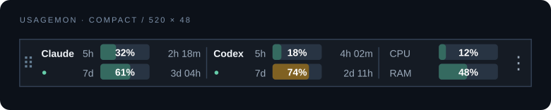

# UsageMon

[](https://github.com/harisbashir/usagemon/actions/workflows/build.yml)

A compact, always-on-top Windows widget for **Claude and Codex subscription limits**, reset countdowns, CPU, and RAM. Drag it onto a clear part of your taskbar and lock it there.



*Layout preview with illustrative values. Percentages show allowance **used**.*

- Five-hour and weekly usage shown as progress bars with percentages overlaid, when reported by your subscription.
- Live reset countdowns and full reset timestamps in tooltips.
- System-wide CPU and physical RAM usage, sampled every two seconds.
- Compact 520 × 48 overlay with saved position, lock, taskbar snap, and tray controls.
- Optional launch at Windows sign-in.
- Native C# / WPF. No Electron, local web server, API keys, or inference calls.

## Download and run

Requires **Windows 10/11 x64** and subscription-authenticated CLI tools for the provider readings. CPU/RAM work independently.

1. Download **UsageMon-win-x64.exe** from [Releases](https://github.com/harisbashir/usagemon/releases/latest).
2. Save it in a permanent folder and run it. This is a standalone executable with .NET and the Claude helper built in; no ZIP extraction or scripts folder is required.
3. Right-click the widget → **Connection setup**. For Claude, click **Set up Claude automatically**, then restart Claude Code.
4. Drag the widget onto an unused part of the taskbar, then **Lock position**. Use **Snap over taskbar** as a starting position.

The ZIP download is also available. Already have the **.NET 10 Windows Desktop Runtime x64**? Choose the smaller `UsageMon-win-x64-framework-dependent.exe` or its ZIP. All downloads run the same widget.

The overlay covers whatever is beneath its own rectangle. It does not reserve space inside Explorer's taskbar. Place it clear of Start, pinned apps, and the clock. It is normally 520 × 48 logical pixels and follows Windows display scaling. On narrower monitors it scales down to keep every control visible.

The releases are unsigned, so Windows may show an unknown-publisher prompt. Only run builds from a source you trust.

## Connecting your accounts

### Codex

Install the [official Codex CLI](https://developers.openai.com/codex/cli/) and authenticate with your ChatGPT subscription:

```powershell
npm install -g @openai/codex
codex login
```

Restart UsageMon after installing the CLI so it receives the updated PATH. UsageMon starts its own `codex app-server`, completes the documented handshake, and reads `account/rateLimits/read`. It refreshes every minute and retries failures with backoff up to five minutes. **Refresh usage** requests an earlier retry.

UsageMon tracks **Codex allowances through your ChatGPT account**, not ChatGPT conversation quotas or API billing. Windows from the `codex` bucket are identified by their reported duration. If your plan reports only weekly limits, the five-hour reading stays `—`.

### Claude

Install a current [Claude Code](https://code.claude.com/docs/en/overview) and sign in using your Claude subscription. UsageMon receives the documented `rate_limits` data through Claude Code's [status line](https://code.claude.com/docs/en/statusline), which includes percentages and reset timestamps.

Open **Connection setup** in UsageMon and click **Set up Claude automatically**. This installs the embedded helper into `%LOCALAPPDATA%\UsageMon\claude-statusline.ps1`, adds the `statusLine` property to your Claude user settings, and preserves other settings. A timestamped backup of the original settings is made alongside the settings file before changing it. Existing UsageMon configurations can be upgraded by clicking the same button again.

Restart Claude Code and work normally. The bridge displays a small usage line in the terminal and saves only normalized usage windows and an observation timestamp to `%LOCALAPPDATA%\UsageMon\claude-usage.json`. The widget reads that file every five seconds. If `CLAUDE_CONFIG_DIR` is set, setup uses that directory's `settings.json`; otherwise it uses `%USERPROFILE%\.claude\settings.json`.

**Existing custom status line?** Automatic setup leaves it unchanged and installs the helper for manual integration. Expand **Manual setup / existing custom status line** for the generated configuration and copy button. Malformed settings files are left untouched.

Claude readings update **when Claude Code emits status data**. Website-only activity does not independently trigger a refresh. Readings older than five minutes are labeled **stale**. Until Claude Code reports limits, the widget shows a setup/waiting state. An API-key-only Claude login may not supply subscription limits.

**Already have a custom status line?** Keep it and forward the same stdin to both scripts. For example, in an existing PowerShell status-line script:

```powershell
$payload = [Console]::In.ReadToEnd()
$payload | & (Join-Path $env:LOCALAPPDATA 'UsageMon\claude-statusline.ps1') | Out-Null
# Pass $payload to your existing renderer instead of reading stdin a second time:
$payload | & powershell.exe -NoProfile -File 'C:\path\to\your-original-renderer.ps1'
```

UsageMon updates Claude settings only when you click the setup button, preserving unrelated properties and backing up the original file. It never reads OAuth secrets or calls undocumented Claude subscription endpoints.

## Controls and status

| Control | Behavior |
| --- | --- |
| Drag widget | Move it when unlocked |
| Right-click or `⋮` | Connection setup, refresh, lock, snap, launch at sign-in, hide, exit |
| Tray double-click | Show the widget |
| Tray right-click | Open controls |
| Hover a provider | Full reset dates, last observation time, and connection errors |
| Close / Alt+F4 | Hide to the tray; use Exit UsageMon to quit |

`—` means the provider has not reported that window or reset time. **Updating** means the reported reset passed; UsageMon waits for authoritative data rather than guessing a new window or changing usage to zero. Failed refreshes preserve the last good reading and mark it stale. System metrics keep working if either provider is unavailable.

Position and lock settings are stored in `%LOCALAPPDATA%\UsageMon\settings.json`. Optional startup uses the current user's `HKCU\Software\Microsoft\Windows\CurrentVersion\Run\UsageMon` value. Disable startup before moving or removing the app. To uninstall, exit, remove the Claude bridge setting if used, then delete the downloaded EXE or extracted folder and optional `%LOCALAPPDATA%\UsageMon` data.

## Build and test

Requires the [.NET 10 SDK](https://dotnet.microsoft.com/download/dotnet/10.0). Build on Windows:

```powershell
dotnet build UsageMon.sln -c Release
dotnet test tests/UsageMon.Tests/UsageMon.Tests.csproj -c Release
dotnet test tests/UsageMon.WindowsTests/UsageMon.WindowsTests.csproj -c Release
powershell -NoProfile -File tests/Test-ClaudeBridge.ps1
./scripts/publish.ps1
# Smaller package for machines with .NET 10 Windows Desktop Runtime:
./scripts/publish.ps1 -FrameworkDependent
```

The portable EXE and ZIP are written to `artifacts/UsageMon-win-x64.exe` and `artifacts/UsageMon-win-x64.zip`. The standalone EXE embeds the Claude bridge, so it works without any sidecar files. `./scripts/publish.ps1 -Runtime win-arm64` can cross-publish an ARM64 build, which is not covered by the x64 Windows checks.

Core tests run on Linux/macOS too; the solution supports Windows cross-compilation, but native tests and the app need Windows:

```bash
dotnet test tests/UsageMon.Tests/UsageMon.Tests.csproj
dotnet build UsageMon.sln -p:EnableWindowsTargeting=true
```

GitHub Actions builds on Windows, runs core/native tests, checks the Claude bridge with PowerShell 5.1 and 7, and publishes standalone self-contained and framework-dependent EXEs plus ZIPs. Tagged releases attach those files automatically to an existing GitHub release. Interactive taskbar, mixed-DPI, resume, and resource-footprint checks are tracked in the [manual smoke checklist](docs/manual-smoke-test.md); compilation alone does not verify them.

## Implementation

`UsageMon.Core` contains parsing, freshness, display formatting, placement geometry, and the read-only Codex transport. `UsageMon.App` contains the WPF strip, native system metrics, physical-pixel monitor placement, and tray controls. There are no third-party runtime dependencies beyond the installed provider CLIs. The Codex CLI runs a separate app-server process; include that process when measuring total resource use.

MIT licensed. Unofficial project; not affiliated with Anthropic or OpenAI.
